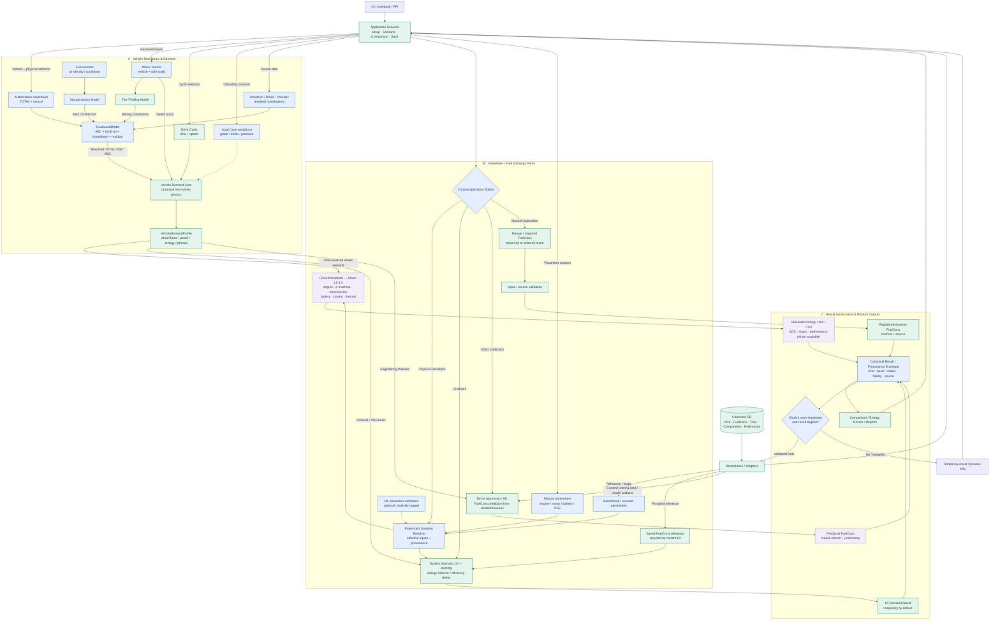
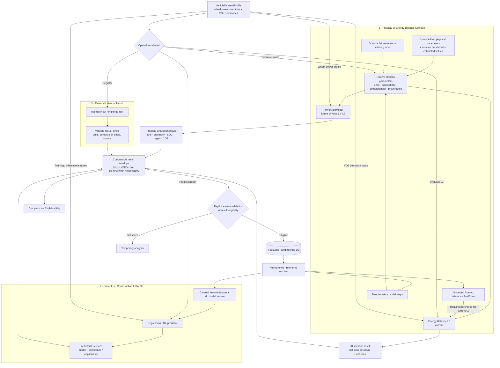
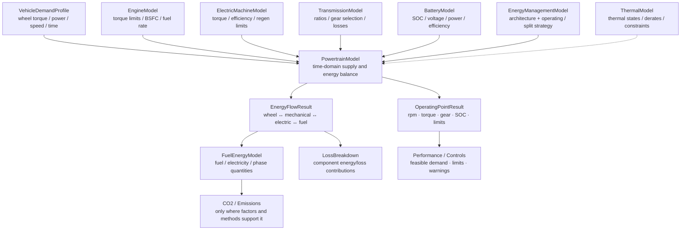
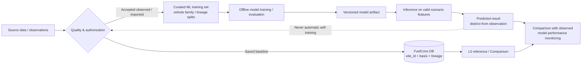

# EcoDrive — Integrated Engineering System Architecture (TARGET v0.2)

**Document type:** System/Software Architecture Description (MBSE-lite)  
**Status:** **TARGET / DESIGN PROPOSAL — NOT AN AS-BUILT CLAIM**  
**Date:** 2026-11-07  
**Repository placement:** `EcoDrive-Analyst/docs/architecture/ECODRIVE_ENGINEERING_ARCHITECTURE_TARGET_v0.2.md`  
**Scope:** vehicle configuration → physical resistance → vehicle demand → powertrain / energy / consumption → results, comparison and optional persistence.  
**Basis:** EcoDrive's existing contracts, `POWERTRAIN_SCENARIO_ARCHITECTURE_GUIDELINES`, Sprint 14–18 roadmap, and Architecture C+ discussion. Source inspection: `caiohfr/projects`, `main` at `f588c7423ac707e08fae43ed2b6ccfbf20908d1a` (2026-11-07). Code has **not** been changed or tested for this document.

## 1. Architectural intent

EcoDrive shall expose **interoperable engineering capabilities** through stable physical inputs/results, with **Application Services** owning data access, scenario selection, orchestration, and explicit persistence. There is no universal superclass requirement. The principal physical separation is:

> **Vehicle Demand asks what the vehicle requires at the wheels; Powertrain asks how that demand is supplied.**

Three distinct paths may create consumption/energy results: **physics or L0 scenario calculation; regression/ML prediction; manual/imported external result**. ML may also estimate *input parameters* for physical models; this does not turn a statistical estimate into a measured physical property. The system must not silently merge these origins.

## 2. System-level architecture — single integrated diagram

The authoritative overview below uses **solid arrows for intended data/operation flow** and **dashed arrows for optional or future integrations**. Labels such as `Model` describe logical engineering roles, **not proof a Python class with that name currently exists**. Current, proposed, and future boundaries are differentiated by text, the source table in §3, and styling (where Mermaid styling is supported).



### Read this diagram in four stages

1. **Source / application:** UI, repositories and DB are separate from numerical engineering models; services resolve an explicit input snapshot.
2. **Upstream physics:** mass/loads + tires, aero and component losses feed Roadload; an authoritative coastdown remains distinct from component build-up. Roadload yields a resolved ABC/boundary; Vehicle Demand combines roadload, test/inertial mass and a drive cycle to produce a time-resolved profile and VDE.
3. **Energy / powertrain:** Powertrain paths share a traceable scenario context but do **not** imply identical models or fidelity. The current L0 consumes a **saved FuelCons reference**, whereas a future detailed physics model consumes a **wheel-power time trace**. Direct statistical prediction and manual/imported result registration are separate methods.
4. **Results / governance:** normalized *comparability metadata* (not equal scientific authority) enables comparison; persistence requires an explicit eligible save action.

## 3. Capability allocation & maturity (as inspected vs target)

| Logical capability | Current known implementation / owner | TARGET responsibility | Maturity |
|---|---|---|---|
| Vehicle / mass state | `vde_calculation_mass.py`; mass resolvers; load-case service | Mass, inertia, axle loads, provenance | CURRENT functions; class proposed |
| Tire / rolling | `roadload/tire_model.py`, `tire_roadload_service.py` | Resolved rolling contribution with conditions/units | CURRENT functions; standardized interface proposed |
| Aero | `vehicle_demand/physics.py` and VDE resolver / CdA functions | Aero contribution under explicit air density/conditions | CURRENT physics; independent class optional |
| Transmission / brake / losses | VDE component resolvers and component databases | Non-overlapping compatible roadload terms | CURRENT partial sources; unified contract proposed |
| Roadload | `roadload/models.py`, `roadload/engine.py`, `vde_workflow_service.py` | `RoadLoadModel` owning force, power, build-up, physical fractions, reconciliation | CURRENT ABC/legacy engine; integrated decomposition TARGET |
| Vehicle Demand | `vehicle_demand/{contracts,engine,adapters}.py` + `vde_calc.py` | Authoritative VDE profiles/summary, TOTAL/NET, signed residual | CURRENT canonical physics; do not duplicate |
| Load Case | `vehicle_demand/load_case.py` | Temporary changes to operating conditions, no database write | CURRENT |
| Powertrain Scenario L0 | `system_scenario/{resolver,l0_adapter}.py` | What-if energy balance / PSE deltas from saved FuelCons reference | CURRENT, not full detailed simulator |
| Manual/Imported FuelCons | `fuel_estimation.py`, legacy `pwt_fuel_energy.py` | Register observed/imported result from primary Powertrain UI | CURRENT engine, TARGET primary UI integration |
| Fuel consumption regression / ML | `fuel_estimation.py`, `regression.py`, `ml_prediction.py` | Direct prediction with dataset eligibility and model version/uncertainty | CURRENT prediction routes; robust dataset governance TARGET |
| Full physical Powertrain | Proposed engine, motor, transmission, battery, thermal, strategy models | Time-resolved energy conversion and dynamics by fidelity | FUTURE (L1–L3) |
| Comparison / visualization | `comparison_report_service.py`, Comparison page | Display canonical results/lineage, no hidden physics | CURRENT with TARGET harmonization |
| Canonical data, history & save | SQLite, repositories, VDE/FuelCons save services | Explicit validated writes, revision, provenance, linkage | CURRENT; target interface refinements |

**Important:** the words CURRENT/FUTURE refer to capability presence, not audited completeness, scientific validation, or automatic behavior in every UI path.

## 4. Powertrain routes — detail and correct interpretation



### 4.1 Future PowertrainModel — logical submodels & ports

This is **a future capability breakdown**, not a prescription for one Python class per box. Each submodel provides a resolved, versioned physical contract to the integrating Powertrain block. The time-domain model must handle architecture applicability: ICE, HEV, PHEV and BEV do not share the same active components.



**Port rule:** the Roadload and Vehicle Demand domains do not import this model; upstream results flow toward Powertrain. Any closed-loop optimization or co-simulation, if later required, belongs in a separate orchestration/solver with convergence criteria rather than circular imports among models.

### 4.2 Parameters vs results are different inputs

- **Manual powertrain parameters:** efficiency, PSE, gear/ratio, motor and battery assumptions supplied for scenario calculation; may be replaced by sourced benchmarks or ML-inferred parameters. These enter a **resolver**, not directly the FuelCons results table.
- **Manual/imported FuelCons:** an externally known or declared final consumption/energy result associated to a VDE and comparison basis. This is **not** a physical Powertrain simulation merely because the user typed it.
- **Direct regression/ML:** predicts FuelCons / energy / CO2 quantities from an **eligible feature snapshot** and model artifact, with applicability, version, method and uncertainty metadata. It does not require an EngineModel.
- **Existing L0:** uses reference FuelCons that has already been persisted; creates temporary scenario results by default. It does not silently create new FuelCons records.
- **Future physical Powertrain L1–L3:** consumes time-domain wheel demand and its own resolved parameters, and calculates the vehicle's energy-supply behavior at the fidelity actually supported. Components such as EngineModel, eMachineModel, BatteryModel, TransmissionModel, ThermalModel and control strategy are **future logical roles**; their existence is not asserted.

### 4.3 Fidelity ladder

| Fidelity | Canonical focus | Necessary inputs | Intended result |
|---|---|---|---|
| L0 (current) | Energy balance / relative PSE assumptions | VDE summary or demand basis + saved FuelCons reference + deltas | Scenario comparison (not auto-saved FuelCons) |
| L1 (future) | Simplified efficiencies and energy flow | Wheel power time series; drivetrain/engine/motor approximations | Fuel/electrical energy estimate |
| L2 (future) | Operating-point maps | Velocity, wheel torque/power, gears/ratios, efficiency/BSFC maps | Operating points and energy losses |
| L3 (future) | Hybrid control and dynamics | Time-resolved demand + engine/motor/battery + SOC/control + constraints | Engine/motor split, regen, SOC, fuel/electrical energy |

**No implicit promotion:** calculated, estimated, observed, imported, and homologated/approved are different claims. A registered result is “observed” only when its provenance supports it.

## 5. Interfaces (mini ICD — Interface Control Document)

| ID | Producer → consumer | Contract / minimum payload | Critical invariants |
|---|---|---|---|
| `IF-01` | Repository → Application Service | IDs, source revision, vehicle configuration, component references, immutable DB snapshot | No hidden SQL in pure model; missing ≠ zero |
| `IF-02` | Mass → Tire | Front/rear loads, load basis, mass distribution, operating pressure | Correct axle/load basis; no double mass counting |
| `IF-03` | Tire/Aero/Loss → Roadload | Component name, source, ABC *or physically evaluated force law*, applicability, test conditions, boundary and non-overlap flags | Matching units/conditions; no duplicated transmission/axle/hubs |
| `IF-04` | Coastdown → Roadload | Authoritative ABC in N, N/(km/h), N/(km/h)^2; source, test conditions, boundary | TOTAL authoritative; component residual signed |
| `IF-05` | Roadload → Vehicle Demand | `RoadloadCoefficients` TOTAL mandatory, NET optional when transmission neutral drag known | Never infer NET = TOTAL; preserve physics |
| `IF-06` | Mass/Cycle/Load Case → Vehicle Demand | Mass used in calculation, time_s, speed_mps, optional grade/trailer/ambient | Grade/trailer are load-case overlays, not auto-persisted coastdown |
| `IF-07` | Vehicle Demand → Powertrain physics | `VehicleDemandProfile` time, speed, acceleration, force, signed wheel power, mode/basis, cycle ID | Wheel demand is not fuel demand; regen potential ≠ captured energy |
| `IF-08` | VDE/FuelCons + resolved scenario → L0 | VDE energy basis, reference FuelCons ID, PSE/deltas, lineage | Reference saved FuelCons required in current L0; no automatic save |
| `IF-09` | DB/Features → Regression/ML | Curated features, training eligibility, model id/version, feature/basis compatibility | Prevent leakage; predictions never become observations automatically |
| `IF-10` | External input → FuelCons registration | `vde_id`, cycle/comparison basis, Urban/Highway/Combined if applicable, units, source, qualifiers | User-entered does not necessarily mean measured; validate completeness |
| `IF-11` | All calculation routes → Comparison | `result_kind`, method, effective input, VDE ID, cycle, result metrics, quality, provenance, warnings | Shared comparison does not imply same evidence/fidelity |
| `IF-12` | Save case → Repositories | Eligible canonical FuelCons/VDE row + review/confirm + lineage/reference links | Explicit write; no save from mere calculation/preview |

**Interface stability rule:** Do not replace existing `VehicleDemandRequest`, `VehicleDemandResult`, `FuelEstimateRequest`, `FuelEstimateResult`, `SystemScenarioResult` or `EquivalentABC` implicitly. Introduce adapters where necessary; audit callers and golden parity before changing signatures.

## 6. Output taxonomy and governance

A proposed *logical result envelope*, **not a new DB table asserted to exist**, should contain:

```text
ResultEnvelope
  identity: {scenario_id, vde_id, optional fuelcons_id, parent/reference ids}
  method: {MANUAL_IMPORTED | L0_SCENARIO | PHYSICS_SIMULATED | REGRESSION | ML_PREDICTED}
  status: {DRAFT | CALCULATED | SAVED | STALE | UNAVAILABLE}
  comparability: {legislation, cycle_name, cycle_version, comparison_basis, roadload_basis}
  sources: {observed/assumed/estimated/model-built, model_version, evidence_quality}
  outputs: {urban, highway, combined, fuel_energy, electrical_energy,
            CO2, PSE, regen, SOC, performance}  # fields optional by method/fidelity
  evidence: {input_snapshot, warnings, uncertainty, applicability, provenance}
```

- `vde_id` is **mandatory for persisted canonical FuelCons records**. A temporary prediction may carry an in-memory VDE reference but must not be treated as persisted automatically.
- One canonical FuelCons line is one comparable energy/consumption result for a VDE; `comparison_basis` and cycle/regulation remain explicit. Urban/Highway/Combined are first-class columns when applicable; supplemental tests (e.g. US06/SC03/Cold FTP) remain distinct results per existing data contract.
- `reference_fuelcons_id` groups related complementary FuelCons records **where applicable**; a selected L0 reference is a separate explicit scenario dependency and must not be inferred merely from that grouping field.
- Results may be displayed together only if compatibility checks permit: metric units, basis, fuel/electrification, regulation, cycle, energy boundaries and method provenance.
- Persisting a simulated or predicted FuelCons requires a **future approved eligibility specification**; no current automatic assumption that every temporary result is savable.

## 7. ML data path and model governance



The EcoDrive database is a possible source of **curated training examples**, not an undifferentiated target feed. Exclude/pin non-authoritative estimates as training targets unless an explicit training objective/labeling policy justifies them. Evaluate splits to prevent leakage between vehicle variants, revisions, shared VDEs and related lineages. Store dataset/model versions and inference inputs. ML-derived missing PWT parameters are *hypotheses* with distinct provenance; direct ML FuelCons predictions are **not** the PowertrainModel's calculated result.

## 8. Physical constraints / invariants

1. `RoadLoad`: `F_road(v_kph)=A+B*v_kph+C*v_kph²`; known physical component force + signed residual equals the authoritative total when the decomposition has compatible boundaries. Mathematical A/B/C fractions are **not** physical fractions.
2. `TOTAL/NET`: TOTAL is coastdown; NET exists only when the neutral transmission loss is resolved by the established contract; no silent substitution and no double-count of axle/hubs/trans.
3. `Vehicle Demand`: preserve canonical `compute_vde_series()` semantics, test mass and cycle. Roadload force, inertia, braking and wheel power are distinct physical quantities.
4. `Powertrain`: demand at wheels is the required supply side input. Do not recalculate Roadload inside Powertrain, and do not label negative wheel energy as actual battery regeneration without electric-machine/battery/strategy limits.
5. `Provenance`: original → correction → effective parameter; result origin, assumptions, model and data revisions are retained. Unknown component/metric is not an explicit zero.
6. `Persistence`: previews, Load Case, Quick Scenario and L0 computations do not write by default; DB Management stages/reviews/commits explicitly. UI charts never become a parallel calculation engine.
7. `Scaling`: cached resolved inputs without hidden DB loops; Roadload force O(n) and component breakdown O(nk) in n speeds/k components; execute benchmarks and SQL counts before claiming speedups.
8. `Scientific claims`: model built ≠ coastdown measured; regression fit ≠ physical decomposition; external manual ≠ approved homologation; confidence metrics must be calibrated/validated before interpreted probabilistically.

## 9. Key use cases and verification plan

| UC | Scenario | Expected observable outcome | Verification tier now |
|---|---|---|---|
| `UC-01` | Select VDE baseline, run Roadload/Vehicle Demand | ABC/boundary, force curve, VDE profile, signed residual | Existing code inspected; test run PENDING |
| `UC-02` | Tire input change | Consistent rolling contribution and new resolved roadload; no mutation of source | TARGET integration; PENDING |
| `UC-03` | VDE selected, no FuelCons yet; enter external consumption | Manual/imported record with vde_id and cycle/source after explicit save | Existing legacy engine; primary UI flow TARGET |
| `UC-04` | VDE + saved reference FuelCons, compare an L0 scenario | L0 scenario result and PSE changes; no automatic FuelCons save | Existing L0 inspected; test run PENDING |
| `UC-05` | Predict FuelCons via regression/ML | Estimate with model/dataset provenance and applicability, not labeled observed | Existing method; rigorous target contract PENDING |
| `UC-06` | Future L2/L3 powertrain on wheel-demand profile | Engine/motor/battery powers, energy balance, SOC/regen, fuel/CO2 | FUTURE; no implementation claimed |
| `UC-07` | Compare outputs from different routes | Explicit method/fidelity/cycle compatibility, warnings for invalid comparisons | TARGET harmonization |
| `UC-08` | Audit new capability from repository through model/result | Requirements → interface → unit/integration/golden test → report | MBSE-lite, tests pending |

### Verification and validation gates

- Freeze test fixtures and result snapshots for TOTAL/NET, tire/aero changes, VehicleDemandProfile, manual FuelCons save/compare and current L0. Tag evidence as `DIRECT_TESTED`, `INDIRECT_COVERAGE`, `INSPECTION_ONLY`, `GAP`.
- Time-domain powertrain fidelity requires **energy-balance checks**, torque/power limits, SOC closure and anti-double-count of losses/regeneration.
- ML requires split/holdout evaluation, leakage audit, missing-features handling, out-of-domain behavior, model version pinning and comparison against simple baselines.
- UI acceptance requires a **real browser smoke** distinct from Streamlit AppTest. No test executions are claimed by this document.

## 10. Recommended documentation ownership and change control

- **Master target**: this file describes desired physical connections, method bifurcation, and source/result governance.
- **Roadload detail**: `roadload_system_design_v0.1.md`, `roadload_flow_map_v0.1.md`, `roadload_traceability_v0.1.md`, `decisions/ADR-14A-005-roadload-model-application-service.md` remain authoritative for Roadload-specific decisions until revised.
- **Existing Vehicle Demand architecture**: `vehicle_demand_architecture.md` remains authoritative for current canonical VDE contracts and behaviors.
- **Powertrain details**: the guidelines and Sprint 14–18 roadmap remain controlling for existing L0 and Manual/Imported rollout. Physical L1–L3, data-driven model governance and save eligibility are future specs.
- **Current vs target control:** any new implemented capability must update the relevant maturity row, interface IDs and verification evidence in the same PR. No diagram implies a deployed capability by itself.

### Proposed placement (do not overwrite existing files)

```text
EcoDrive-Analyst/
└── docs/
    └── architecture/
        ├── ECODRIVE_ENGINEERING_ARCHITECTURE_TARGET_v0.2.md  # this file
        ├── ecodrive_engineering_master_v0.2.mmd                # editable master diagram
        ├── vehicle_demand_architecture.md                     # existing / keep
        ├── roadload_system_design_v0.1.md                     # earlier Sprint 14A addition
        └── decisions/ADR-14A-005-...md                        # earlier decision
```

**Approval status:** conceptual design for review; no code changes, no new schema and no unexecuted tests represented as PASS.
