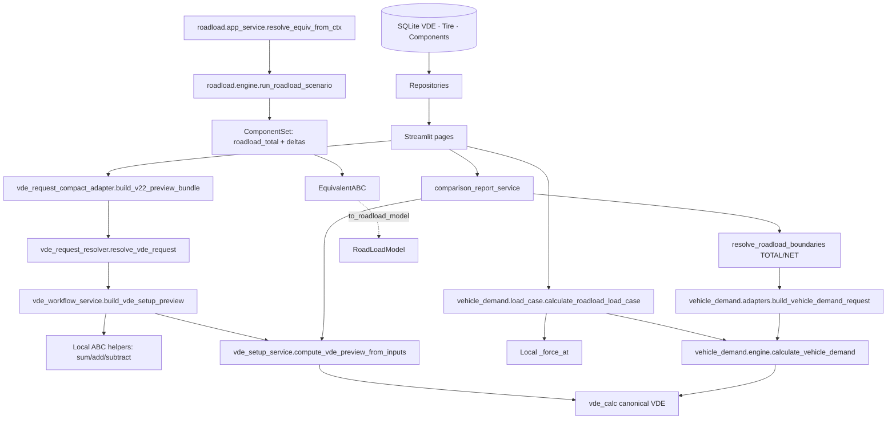
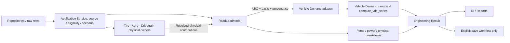

# EcoDrive — Roadload Dependency & Caller Audit v0.1

**Sprint:** 14A-03 · **Estado:** INSPECTION ONLY / TARGET PROPOSED  
**Fonte:** `caiohfr/projects`, `EcoDrive-Analyst`, branch `main`, commit `fca9a9ad189fe7e6930e987e29fee5717c0d532e`, consultado em 2026-11-07.  
**Escopo:** consumidores e fronteiras mais relevantes de Roadload/Vehicle Demand. Busca textual no GitHub + inspeção de trechos; **não** inventário AST completo, **não** execução de código, testes, SQL nem benchmarks.  
**Relação:** complementar, sem substituir `docs/architecture/roadload_flow_map_v0.1.md` e `roadload_system_design_v0.1.md`.

## 1. Conclusão de engenharia

O EcoDrive **não** possui atualmente um único motor de Roadload usado por todas as fatias verticais. A classe `RoadLoadModel` existente implementa `force`, `power`, `summary`, `to_dict`, recebendo `A`, `B`, `C`, `mass_kg` e `name`. A ponte `EquivalentABC.to_roadload_model()` existe, mas os principais fluxos de VDE usam outros contratos/funções. Isso é dívida de integração, **não bug confirmado**. Não substituir os fluxos diretamente sem testes de paridade.

## 2. Diagrama de execução CURRENT (simplificado e fiel ao papel de cada módulo)

**Nota:** setas representam caminhos selecionados observados na inspeção, não necessariamente toda a sequência de chamadas em cada evento de UI. O adaptador de Vehicle Demand **importa** a resolução de fronteiras do Comparison; a seta `BOUND → VDA` representa reutilização lógica dessa função, não uma chamada automática do Comparison para o adapter.

## 3. Inventário qualificado de consumidores / operações

| Ponto do código atual | Papel observado | Autoridade / consequência | Ação TARGET | Evidência |
|---|---|---|---|---|
| `roadload/models.py :: RoadLoadModel` | `force`, `power`, summary, ABC e `mass_kg` | Classe física simples; nenhuma consulta DB | Expandir métodos sem quebrar construtor/exports | INSPECTION |
| `roadload/models.py :: RoadLoadComponent`, `ComponentSet`, `EquivalentABC` | Contratos e soma ABC; ponte de resultado → modelo | DTOs legados públicos | Manter adaptação/compatibilidade; absorção do set somente após mapa de callers | INSPECTION |
| `roadload/engine.py :: run_roadload_scenario` | Baseline → `roadload_total` → deltas → `EquivalentABC` | O `roadload_total` atual **não** é breakdown físico | Preservar API, não rotular `roadload_total` como componente físico independente | INSPECTION |
| `roadload/app_service.py :: resolve_equiv_from_ctx` | Construção de request a partir do contexto da UI | Ponte legada para engine | Futuro adapter, mantendo assinatura por enquanto | INSPECTION |
| `tire_roadload_service.py :: build_tire_component_from_result` | Resultado de pneu → `RoadLoadComponent` com ABC e metadados | Ponte física concreta disponível | Validar shape/disponibilidade/proveniência e uso em build-up | INSPECTION |
| `roadload/tire_model.py :: calculate_vehicle_tire_abc`, `calculate_applied_rrc_by_axle` | Física dos pneus e cargas por eixo | Autoridade Tire; SAE/ISO permanecem ali | Interface de contribuição resolvida; não copiar equações | INSPECTION |
| `vde_workflow_service.py :: build_vde_setup_preview` | ABC total por baseline/manual/componentes; TOTAL/NET; VDE preview | Serviço de aplicação com soma local, persistência separada | Migrar após golden; manter semântica dos roles e do source mode | INSPECTION |
| `vde_request_resolver.py :: resolve_vde_request` | Walk From, domínios, lookups, preview; carrega componentes | Importante para cenários e provenance | Service continua orquestrador; RoadLoadModel não assume Walk From | INSPECTION |
| `vehicle_demand/load_case.py :: _force_at` | Avaliação ABC direta em fixed speed/sweep, grade/trailer/correções fora de ABC | Duplicação matemática localizada; regras Load Case especiais | Candidato à consolidação **depois** da paridade | INSPECTION |
| `vehicle_demand/engine.py :: build_vehicle_demand_profile` | Usa `compute_vde_series`, conhecido rolling/aero/residual e VDE | Autoridade de energia, inércia, clipping e integração | Roadload fornecer ABC; **não** substituir física VDE | INSPECTION |
| `vehicle_demand/adapters.py :: build_vehicle_demand_request` | VDE row → TOTAL/NET, massa, ciclo, provenance | Importa `comparison_report_service`; risco de ciclo se inverter dependências | Isolar contrato/resolver de fronteira em momento posterior | INSPECTION |
| `comparison_report_service.py :: resolve_roadload_boundaries` | TOTAL e NET a partir de trans disponível/temporária | Contrato canônico TOTAL/NET atual | Preservar, mover só com caller graph e testes | INSPECTION |
| `comparison_report_service.py :: resolve_cycle_vde_results` | VDE on demand por base TOTAL/NET | Reutiliza `compute_vde_preview_from_inputs` | Consumir outputs sem calcular física nova | INSPECTION |
| `quick_scenario/resolver.py` | Cenários temporários integrados ao Vehicle Demand | Mais um consumidor a considerar | Inventariar detalhadamente por AST antes de migrar | SEARCH / DEPTH PENDING |
| `system_scenario/legacy_adapter.py` | Consome Vehicle Demand | Integração com sistema de cenários | Preservar contrato; não forçar dependência de RoadLoadModel | SEARCH / DEPTH PENDING |

### Achado que exige cuidado especial

`vehicle_demand/adapters.py` hoje importa `resolve_roadload_boundaries` do `comparison_report_service.py`; a arquitetura-alvo não deve criar o caminho reverso `comparison_report_service → vehicle_demand.adapter → comparison_report_service`. A solução ideal é extrair o resolvedor puro de fronteira para um módulo físico neutro **apenas depois de mapear consumidores e executar golden tests**. Não se exige essa extração na Sprint 14A.

## 4. CURRENT → TARGET (sequência sem big bang)

Roadload **não** acessa DB, Streamlit, Plotly, nem chama Vehicle Demand. A rede física é direcional; service orquestra sem criar ciclo de importações entre domínios.

## 5. Ordem de migração recomendada (posterior ao design gate)

1. **Compatibilidade no domínio:** manter `RoadLoadModel(A,B,C,mass_kg,name)`, exports de `roadload/__init__.py`, `RoadLoadComponent`, `ComponentSet`, `EquivalentABC.to_roadload_model()`; adicionar testes aos métodos puros. Não migrar callers.
2. **Contrato Tire → Roadload:** usar `build_tire_component_from_result`, evitar `missing→0`, registrar basis do cálculo de pneu e verificar inclusão/overlap. Não mudar física de pneus.
3. **Roadload Engine clássico:** substituir a soma interna de contribuições por delegação validada ao modelo; manter formato de `EquivalentABC` e nomes públicos.
4. **Load Case Lab:** consolidar avaliação ABC somente após comparar fixed-speed, sweep e ciclo; preservar trailer, grade, massa e cenários sem save.
5. **VDE Setup v2.2:** migrar helpers/síntese com paridade exata do preview e dos papéis de componentes; preservar `save_v22_request` e lineage.
6. **Comparison/Vehicle Demand:** por último, isolar contratos TOTAL/NET e remover dependência de apresentação entre domínios; nenhuma alteração canônica de VDE como parte dessa etapa.

A ordem **não** é compromisso de calendário; respeitar o roadmap de Manual/Imported FuelCons.

## 6. Evidência pendente (não declarar Gate concluído)

- Inventário por AST da árvore completa de imports, instâncias e chamadas dinâmicas (incluindo testes e UI) — **PENDING**.
- Golden fixtures do código atual, regressões TOTAL/NET/VDE/Tire/VDE Setup/Load Case — **NOT EXECUTED**.
- Medição p50/p95, CPU, peak memory, queries SQL e scaling n×k — **NOT EXECUTED**.
- Browser smoke real — **NOT EXECUTED**; AppTest, se feito, é evidência separada.
- Qualquer overlap físico trans + axle/hubs — **REQUIRES RULE AND REVIEW**.

**Proibido inferir que arquivo importado é executado em todas as páginas ou que uma correspondência de busca é uma chamada em runtime.** Este mapa é um inventário estático, inicial, qualificado.
