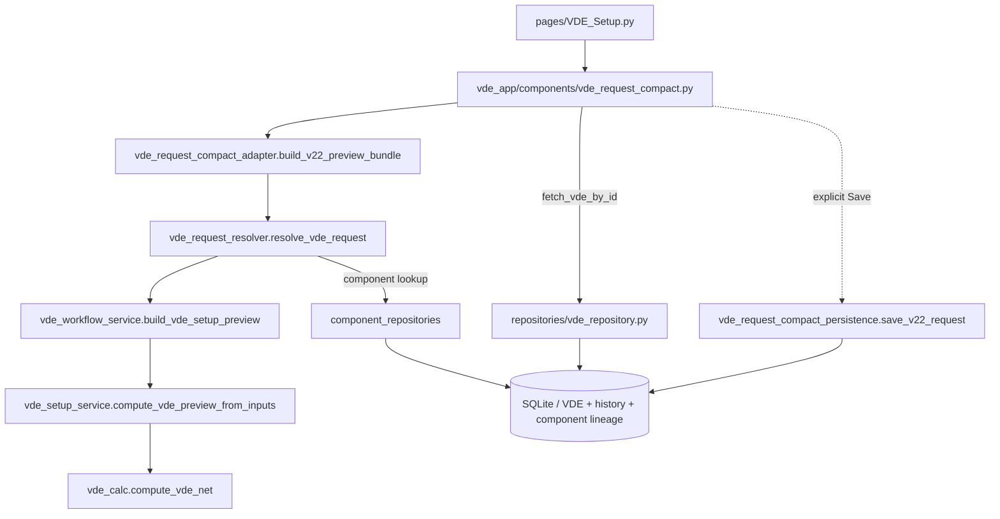
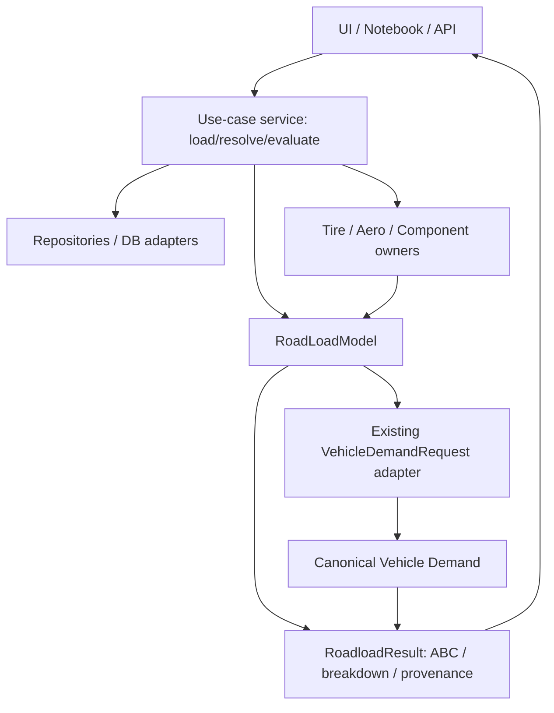

# EcoDrive — Roadload Flow Map CURRENT → TARGET (v0.1)

**Data:** 2026-11-07. **Status:** `CURRENT` verificado por leitura dos módulos da `main` (`f588c742`); `TARGET` é intenção de arquitetura, não implementada. Observação: os caminhos descritos são fatias funcionais, não todos os subpassos nem um grafo AST exaustivo.

## CURRENT — fatias verticais

### 1. VDE Setup v2.2 (preview e save separados)

Evidências: `vde_request_compact_adapter.py` chama `resolve_vde_request`; este chama `build_vde_setup_preview`; no workflow as funções `_sum_components`, `_resolve_initial_abc_total`, `_add_abc` e `_subtract_abc` compõem ABC antes do cálculo VDE. `save_v22_request` realiza gravação histórica e de VDE sob fluxo de save explícito. **O `RoadLoadModel` existente não é a única autoridade de build-up neste caminho.**

### 2. Roadload Engine clássico

`roadload/app_service.resolve_equiv_from_ctx` → `roadload/engine.run_roadload_scenario` → `normalize_roadload_request` → `resolve_baseline` → `build_component_set_from_baseline` → `apply_component_changes` → `synthesize_equivalent_abc` → `EquivalentABC` → `to_roadload_model()` **quando consumidor solicitar**.

O `ComponentSet` atual inicia frequentemente com `roadload_total`, e os deltas alteram esse agregado; **não é uma decomposição por subsistema garantidamente física**. Não interpretar `component_table` como medição individual de perdas.

### 3. Load Case Lab (read-only)

`pages/Roadload_Load_Case_Lab.py` → `vde_app/components/roadload_load_case_lab.py` → `fetch_vde_all_rows/fetch_vde_by_id` e `fetch_fuelcons_by_vde_id` → `vehicle_demand/load_case.calculate_roadload_load_case` → `vehicle_demand/engine.calculate_vehicle_demand` → `vde_calc.compute_vde_series`.

O `load_case.py` resolve massa, condições ambiente, pressão de pneus, grade e trailer. **Há possível leitura indireta ao DB**: `load_case.py` chama `tire_roadload_service.preview_tire_roadload_from_row()`, cujo serviço resolve referências de pneu via repository. O Lab permanece sem Save; **ausência de escrita não é ausência de leitura**.

### 4. Comparison / Energy Drivers

`vde_app/components/comparison_report.py` → `comparison_report_service.build_comparison_dataset` → `resolve_roadload_boundaries` e `resolve_cycle_vde_results` → `compute_vde_for_boundary` → `vde_setup_service.compute_vde_preview_from_inputs` → `vde_calc.compute_vde_net`.

A via de Energy Drivers utiliza `vde_app/comparison_vehicle_demand_viewmodels.py` → `vehicle_demand.calculate_vehicle_demand` → `vde_calc.compute_vde_series`. O adapter `vehicle_demand/adapters.py` importa resolução de boundaries de `comparison_report_service.py`; dependência real, não corrigir copiando regras.

## TARGET — interface comum sem migrar tudo de uma vez

**Princípios:**
- Service faz I/O e resolução, inclusive provenance/overlap, antes de criar modelo.
- `RoadLoadModel` opera em dados resolvidos, sem SQL, Streamlit ou Plotly.
- Roadload pode ser autoritativo com decomposição parcial ou model-built; flags devem impedir que ambos pareçam equivalentes.
- VDE Setup, Comparison e Lab são **consumidores** da mesma semântica, não precisam migrar de uma vez.
- `TOTAL/NET` seguem resolvers aprovados durante transição; sem criar novo fallback.

## Matriz de integração — migração mínima

| Consumidor / módulo | Mudança mínima candidata | Risco principal | Critério de avanço |
|---|---|---|---|
| `roadload/models.py` | Fortalecer validação, `abc_terms`, breakdown, reconcile; manter API antiga | Compatibilidade `A/B/C/mass_kg`, arrays | Testes unitários e consumidores mapeados |
| `roadload/engine.py` | Adaptar saída ao novo contrato, preservar `run_roadload_scenario` | Semântica delta vs componente real | Golden de EquivalentABC / componente |
| `vehicle_demand/load_case.py` | Trocar `_force_at()` somente após paridade; manter resolvers | Linhas 1100+, clima, massa, tire DB reads | Testes Load Case + no writes |
| `vde_workflow_service.py` | Avaliar centralização de operações ABC na fase futura | Save, Walk From, NET e fases VDE | Golden VDE Setup / schema unchanged |
| `comparison_report_service.py` | Usar contrato compartilhado sem copiar `TOTAL/NET` | Dependência do adapter e perda de NET | Golden boundary / comparison |
| `vde_calc.py` | **KEEP** inicialmente | Alterar autoridade numérica | Benchmark e equivalência estrita antes de qualquer mudança |
| `tire_roadload_service.py` | Separar lookup de cálculo puro se o diagnóstico confirmar valor | I/O oculto, regressão tire | Contagem SQL / teste determinístico |

## Fora de escopo do Design Gate

Criação de classes de homologação e conversão 2T/3T; mudanças de schema; publicação de código; migração da UI; microservices; mover `vde_calc` para outro módulo; alteração do fluxograma prioritário Manual/Imported FuelCons. Os artefatos TARGET não autorizam executar a migração.

## Fonte por caminho relevante

`src/vde_core/{vde_request_compact_adapter.py,vde_request_resolver.py,vde_workflow_service.py,vde_setup_service.py,vde_calc.py,comparison_report_service.py}`; `src/vde_core/roadload/{models.py,engine.py,app_service.py}`; `src/vde_core/vehicle_demand/{load_case.py,engine.py,adapters.py}`; `src/vde_core/repositories/{vde_repository.py,tire_roadload_repository.py}`; `src/vde_app/components/{vde_request_compact.py,roadload_load_case_lab.py,comparison_report.py}`. Lidos por inspeção em GitHub; nenhum profiler ou tracing runtime executado.
