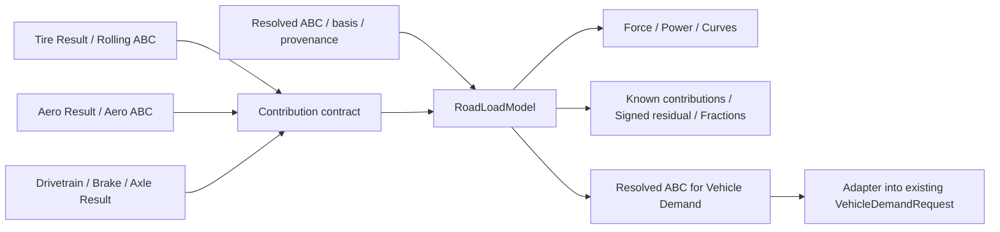

# EcoDrive — Roadload Engineering Interface Contract (DRAFT v0.1)

**Sprint:** 14A-03 · **Status:** PROPOSAL FOR DESIGN REVIEW / NOT IMPLEMENTED  
**Contrato arquitetural:** C+ = Application Service + modelo físico de Roadload + contratos de contribuição de outros Engineering Models.  
**Authority:** preservar TOTAL/NET, Vehicle Demand e física Tire atuais. Este arquivo não revoga contratos já implementados.

## 1. Necessidade e limites

O `RoadLoadModel` é um bloco físico reutilizável para avaliar o Roadload de uma fronteira, combinar contribuições e explicar a parcela conhecida e residual. Não é repositório, resolvedor SAE/ISO, gestor de projetos, regulatório 2T/3T, motor Vehicle Demand, nem solver de powertrain. O service monta e coordena; componentes especializados resolvem suas próprias equações; a troca se dá por valores/contratos.

## 2. Interface Black-Box de engenharia

### Contratos de entrada — proposta (tipos de dados, não classes adicionais obrigatórias)

| Campo | Tipo lógico / unidade | Semântica | Condição |
|---|---|---|---|
| `A_N`, `B_N_per_kph`, `C_N_per_kph2` | 3 números finitos | `F=A+B*v+C*v²`; `v` em km/h | Obrigatórios para avaliar uma fronteira |
| `boundary` | enum `TOTAL`, `NET` | Identifica a fronteira da curva | Obrigatório no input resolvido; ausência de NET não cria fallback |
| `calculation_mode` | `RECONCILE_SOURCE` ou `BUILD_UP` | De onde vem o valor de `ABC` utilizado | Obrigatório no modelo novo |
| `origin` | Source/Estimated/Derived com ID/versão | Observado, inferido ou cenário derivado são origens distintas | Preservar; nunca promover predição a medição |
| `components` | mapa `component_id → contribution` | Apenas contribuições físicas resolvidas e elegíveis | Pode ser incompleto |
| `provenance` | ref e método por valor, versão | Origem de ABC total e de cada componente | Obrigatório para afirmar rastreabilidade |
| `mass_kg` | kg | Mantido por compatibilidade com construtor atual | Não define física de força ABC; massa inercial é de Vehicle Demand |

**N.B.** No `MODEL_BUILT`/build-up sem coastdown autoritativo, o total precisa resultar explicitamente de todas as contribuições incluídas e de eventuais termos adicionais declarados. `RECONCILE_SOURCE` mantém ABC da fonte imutável. Uma **derivação de cenário a partir de fonte** deve conservar referência à fonte e o delta; não pode ser apresentada como medição original. Exata enumeração/nome de modos será fechada no Gate, para não quebrar a nomenclatura de `roadload_system_design_v0.1.md` (`SOURCE_AUTHORITY`/`MODEL_BUILT`).

### Contrato mínimo de contribuição física (por registro)

| Campo | Tipo proposto | Regra física |
|---|---|---|
| `id`, `physical_role` | Texto (ex.: `rolling_front`) | Identidade do subsistema; não usar `roadload_total` como contribuição independente |
| `abc` | ABC resolvido ou `None` | `None` = indisponível; `ABC=(0,0,0)` com `AVAILABLE` = zero conhecido |
| `availability` | `AVAILABLE`, `MISSING`, `NOT_APPLICABLE` | Zero, ausente e não aplicável são estados diferentes |
| `origin`, `source_ref`, `model_version` | Provenance | Medido, estimado ou derivado sem ambiguidade |
| `scope` e `contains_scopes` | conjunto de fronteiras físicas | Evita somar transmissão agregada com axle/hubs já incluídos |
| `valid_boundaries` | subconjunto TOTAL/NET | Uma contribuição só entra em uma fronteira se o contrato permite |
| `conditions` | massa/carga, pressão, ρ etc. relevantes | Não reutilizar contribuição calculada sob condições incompatíveis |
| `notes/uncertainty` | opcional | Informativo; não substituir ausência por valores fictícios |

`RoadLoadComponent` atual já carrega nome, ABC, source e `meta`: mapear ao novo contrato por adapter e manter API legada. No produto futuro, adicionar campos tipados/frozen quando a compatibilidade permitir.

## 3. Operações de `RoadLoadModel` (API-alvo conceitual)

| Método | Entradas | Saídas / responsabilidade | Escala |
|---|---|---|---|
| `force(v_kph)` | escalar/array NumPy | `F_road_N` | O(1) / O(n) |
| `power(v_kph)` | escalar/array | `F*v/3.6` em W | O(1) / O(n) |
| `abc_terms(v_kph)` | escalar/array | `A`, `Bv`, `Cv²` sem atribuição física | O(1) / O(n) |
| `build_up()` | conjunto elegível já resolvido | ABC previsto + cobertura e status | O(k) |
| `breakdown(v_kph)` | escalar/array | força de cada componente e residual **assinado** | O(k) / O(nk) |
| `fractions(v_kph,kind)` | `physical` ou `abc` | parcelas identificadas e máscaras de indisponibilidade | O(k) / O(nk) |
| `reconcile()` | componentes + total | coeficiente/força closure e warnings, sem corrigir baseline | O(k) |
| `with_component_change(...)` | contexto de baseline, before/after | **Decisão pendente**: não misturar reatribuição e alteração de cenário | depende |
| `to_dict/summary` | — | representação serializável com provenance | O(k) |

**Não implementar `with_component_change` sem desambiguar duas operações:** (1) *reclassificar a decomposição* de um coastdown mantendo ABC autoritativo inalterado; (2) *alterar fisicamente um componente* e produzir ABC de cenário derivado por diferença `(ABC_new − ABC_old)` preservando referência do original. No segundo caso, requer `ABC_old` conhecido, ou política de replacement explícita e comprovável. Nunca alterar medição original.

## 4. Leis/invariantes obrigatórios

1. `F(v)=A + B*v + C*v²`, v em km/h, F em N; `P(v)=F(v)*v/3.6` em W.
2. Quando o total é autoritativo e as contribuições são compatíveis: `ABC_residual=ABC_total−ΣABC_known`, implicando `F_total(v)=ΣF_known(v)+F_residual(v)` na fronteira; residual pode ser negativo.
3. Frações `F_i/F_total` não significam necessariamente valores entre 0 e 1. Se `|F_total|≤epsilon`, retornar indisponível, não dividir por zero ou normalizar.
4. Frações `A/F`, `Bv/F`, `Cv²/F` são puramente algébricas; não nomeá-las Aero/Rolling.
5. `TOTAL` é coastdown da fonte; `NET=TOTAL−transmission` somente com transmissão resolvida e contrato de fronteira aplicável. Não somar novamente a transmissão se a contribuição já estiver inclusa em outro agregado. NET ausente permanece indisponível.
6. Componentes com `scope` sobreposto são rejeitados para soma; exemplo: transmissão com axle/hubs inclusos vs axle/hubs isolados.
7. O modelo recebe contribuição física compatível: não converter automaticamente RRC isolado ou força pontual em tripla ABC. Tire calcula/ajusta cargas e pressão; adapter define representação equivalente.
8. Conservação de energia do Roadload (`∫Fv dt`) não é o VDE trativo positivo: inércia, clipping e integração permanecem em `vde_calc.compute_vde_series` e `vehicle_demand`.
9. Nem `RoadLoadModel` nem seus métodos de cálculo fazem `fetch`, `save`, Streamlit, SQL, plots ou side effects. Cenários devem ser reproduzíveis sem modificar baseline.
10. Ausência ≠ zero; NaN/inf são inválidos, unidades incoerentes impedem cálculo, incerteza/estimativa propagam provenance.

## 5. Interface de interoperabilidade Tire → Roadload → Vehicle Demand

| De → Para | Dados | Adaptador/dono existente | Contrato v1 planejado |
|---|---|---|---|
| Repositories → Application Service | `vde_row`, tire front/rear, component records | `repositories/*`; `tire_roadload_service.py` | Nenhuma query no modelo |
| Tire physics → Roadload | `total_final_abc`, pressão, massa de carga, source | `tire_roadload_service.build_tire_component_from_result` + `roadload.tire_model` | Component Contribution explícita; fontes/condições |
| Aero → Roadload | `CdA` + `rho` resolvida → C em unidades canônicas | `roadload.engine.cdA_to_C`, `vehicle_demand.physics.known_aero_force_N` | Não duplicar conversão, densidade não presumida |
| Drivetrain/Brake/Axle → Roadload | ABC por componente | Component repositories / resolver | `scope` e `contains_scopes` obrigatórios para soma |
| Roadload → Vehicle Demand | ABC por fronteira, origens e disponibilidade | `vehicle_demand.adapters` / `VehicleDemandRequest` | Adapter converte para `RoadloadCoefficients`, não importar o modelo diretamente no VDE core |
| Vehicle Demand → Result/Powertrain | series, wheel power, VDE summary | `vehicle_demand.engine` | Reusar contrato atual sem recalcular a força fora do canônico |

## 6. Contratos que NÃO devem mudar neste pacote

- `RoadLoadModel(A, B, C, mass_kg, name=...)`, `force`, `power`, `summary`, `to_dict` permanecem comportamentos legados até prova de paridade.
- `EquivalentABC.to_roadload_model`, `ComponentSet`, `run_roadload_scenario`, `roadload/__init__.py` exports.
- `VehicleDemandRequest.roadload_total` obrigatório, `.roadload_net` opcional.
- `vde_calc.compute_vde_series` como física canônica; cálculos de inércia, potência positiva e energia continuam em Vehicle Demand.
- `comparison_report_service.resolve_roadload_boundaries` continua autoridade de TOTAL/NET no CURRENT; migração depende de dependências.
- Preview/save separados; `save_v22_request` e `FuelCons` não entram em alterações silenciosas.

## 7. Aceitação futura, não validada

- `AC-RL-001`: ABC `(100,0.5,0.03)` a 100 km/h → `F=450 N`, `P=12,500 W`.
- `AC-RL-002`: known components 350 N a 100 km/h sob mesmo total → residual 100 N; known 110 N sob total 100 N → residual −10 N.
- `AC-RL-003`: missing vs zero conhecido, overlaps, NET ausente, fração denominador zero.
- `AC-RL-004`: Tire SAE/ISO resolved → contribution → aggregate ABC; nenhum recálculo da física Tire.
- `AC-RL-005`: parity de golden VDE TOTAL/NET/Load Case/Setup; tolerâncias fixadas antes da implementação.
- `AC-RL-006`: DB query count, P50/P95, CPU, peak memory medidos em ambiente fixo; nenhuma regressão injustificada.

**Status de evidência:** inspeção de fontes concluída parcialmente; AST global, golden, tests e benchmarks **PENDING**. Este documento é uma proposta de interface e **não** um contrato congelado de implementação.
