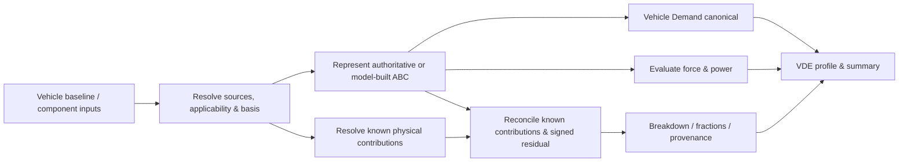
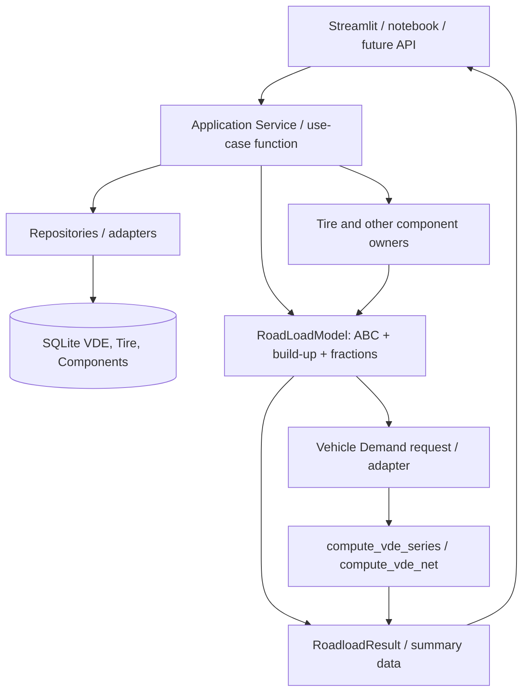

# EcoDrive — Roadload System Design v0.1

**Estado:** TARGET PROPOSED — aprovado conceitualmente o padrão C (`Application Service + RoadLoadModel`), **não implementado**.  
**Sprint:** 14A — descoberta, requisitos, arquitetura, sem alteração de física.  
**Revisão:** 2026-11-07. Referências de arquivos relativos à raiz `EcoDrive-Analyst`.

## 1. Need / intenção do sistema

O analista deve conseguir (1) avaliar o Roadload agregado de um veículo, (2) decompor sua força por componentes físicos identificáveis, mesmo parcialmente, (3) construir uma hipótese de Roadload a partir de contribuições disponíveis, (4) comparar cenários sem alterar baselines autoritativos, e (5) fornecer um ABC inequívoco ao Vehicle Demand para cálculo de VDE.

Os casos-base são cenários com `vde_db`, componentes de pneus/rolamento, aero, transmissão, freios, eixo/hubs/parasitics, múltiplos consumos, e Load Case Lab. **Market, homologação 2T/3T e dyno setting ficam fora do escopo deste incremento** (futuros contratos, não métodos obrigatórios agora). A planilha FIAT compartilhada serviu como referência conceitual, não como dado publicável nem golden case aprovado.

## 2. Functional architecture (independente de classes)



**Verificação ≠ validação:** unit/golden tests verificam contratos e cálculos; validação de produto exige reprodução de tarefas reais com dados e hipóteses autorizados.

## 3. Logical/software architecture — opção C



- **Repository:** busca IDs e registros, nunca aplica física.
- **Application Service:** coordena busca, resolução, origem, fronteira, cenários e eventual persistência explícita. Pode ser uma **função** ou fachada fina; não requer classe nova sem estado que a justifique.
- **RoadLoadModel:** **única classe principal** para avaliar e combinar contribuições de Roadload já resolvidas. Não acessa SQLite, Streamlit, Plotly, regras completas SAE/ISO, políticas regulatórias ou VDE.
- **Component owner (Tire/Aero etc.):** calcula sua contribuição por sua própria equação válida e devolve um contrato pronto para somar ou reconciliar.
- **Vehicle Demand:** recebe ABC+mass+cycle e preserva a implementação canônica de integração de potência e energia.

Não misturar as tarefas de `run_roadload_scenario` (síntese de ABC) com `calculate_roadload_load_case` (condições, massa, grade, trailer e modos de operação) só porque os nomes contêm Roadload.

## 4. Semântica do modelo e estados

`RoadLoadModel` deve oferecer dois modos mutuamente distinguíveis:

**SOURCE_AUTHORITY (coastdown/source):** `authoritative_abc` é fornecido e mantido; as contribuições são **parciais**, com `residual_abc = authoritative_abc - sum(known_component_abc)` apenas se o conjunto de componentes tiver compatibilidade de fronteira e ausência de duplicação. O residual é **assinado**, não é uma peça física identificada e não deve ser distribuído arbitrariamente.

**MODEL_BUILT (predição/hipótese):** o total deriva da soma de componentes modelados **e de termos adicionais explicitamente fornecidos**, com provenance e cobertura explícitas. Não deve ser rotulado de medido, homologado ou completo apenas porque a soma fecha.

Os campos abaixo são **contrato de intenção**, não novo schema já decidido:

| Campo lógico | Propósito | Decisão |
|---|---|---|
| `abc` | Tripla `(A_N, B_N_per_kph, C_N_per_kph2)` válida para uma base | Required para avaliar força |
| `boundary` | `TOTAL` ou `NET`; evita misturar coastdown e dyno | Required no resolved input |
| `mode` | `SOURCE_AUTHORITY` ou `MODEL_BUILT` | Required |
| `components` | Mapa de contribuições identificadas por papel e fronteira | Optional, podem faltar |
| `source_ref / provenance / model_version` | Origem por total **e** por contribuição | Required quando disponível; não inventar origem |
| `warnings / availability` | Ausência, incoerência, overlap, defaults | Explicit |

`RoadLoadComponent` pode permanecer como **DTO/dataclass leve** (nome, ABC, papel, provenance, boundary e flags). **Não é uma segunda engine**. `ComponentSet` é candidato a absorção no modelo, mas seu contrato público atual deve permanecer durante a migração. A classe existente `RoadLoadModel(A, B, C, mass_kg, name)` já possui consumidores; **não remover `mass_kg`** sem auditoria de compatibilidade, ainda que força/potência não usem a massa.

### API pública proposta (não implementada)

```python
roadload = roadload_service.resolve_vehicle(vde_id=42, boundary="TOTAL")
roadload.force(100.0)                 # N, km/h
roadload.power(100.0)                 # W
roadload.abc_terms(100.0)             # parcelas matemáticas A, Bv, Cv²
roadload.breakdown(100.0)             # parcelas físicas conhecidas + residual
roadload.fractions(100.0, kind="physical")
roadload.reconcile()                  # diagnóstico + tolerâncias + availability
scenario = roadload.with_component_change("tires", new_tire)
```

A interface real será especificada antes da implementação, incluindo mutabilidade, tratamento vetorial e versão do contrato. Separar `abc_terms` de `breakdown` impede classificar automaticamente `Cv²` como Aero.

## 5. Regras físicas invariantes

1. **Força:** `F_road(v_kph) = A + B*v_kph + C*v_kph²`, unidades `A [N]`, `B [N/(km/h)]`, `C [N/(km/h)²]`.
2. **Potência:** `P_road_W = F_road_N * v_kph / 3.6`; velocidade convertida uma única vez para SI.
3. **Reconcile:** `F_authoritative(v) = ΣF_known_i(v) + F_residual(v)`, sem forçar residual a zero, atribuir parcelas faltantes a nomes ou normalizar contribuições para 100%.
4. **Fração física:** `F_i/F_authoritative` apenas onde denominador é significativo; pode ser negativa/maior que 1. O tratamento de denominador próximo de zero deve ter política de tolerância explícita; nunca divisão silenciosa.
5. **Fração ABC:** `A/F`, `Bv/F`, `Cv²/F` é **matemática**, não identificação física.
6. **Disponibilidade:** `None/NULL` ≠ zero medido. Sem contribuição conhecida, não afirmar que é zero; guardas contra NaN/Inf.
7. **TOTAL/NET:** TOTAL é coastdown autoritativo; NET somente quando arrasto de transmissão em neutro estiver disponível. `ABC_NET=ABC_TOTAL-ABC_TRANS` onde o contrato atual assim define; não reconstruir TOTAL a partir de NET ou vice-versa quando dados faltam. Evitar dupla contagem de transmissão/axle/hubs.
8. **Mass/inertia/grade:** cálculo de inércia e potência trativa permanece no Vehicle Demand; grade/trailer operam conforme regras do Load Case, não são inseridos implicitamente em coeficientes de coastdown persistidos.
9. **Determinismo:** mesma entrada resolvida e mesmas versões de modelo geram mesma saída, sem consulta oculta ou mutação de baseline.
10. **Write boundary:** cálculo, preview e Load Case não escrevem no DB. Gravação só por caso de uso de save e confirmação explícita.

### Nota sobre conservação energética

`E_road = ∫F_road(v)*v dt` é diferente do cálculo de **VDE trativo positivo**, que envolve massa, aceleração, sinal de potência e integração. Breakdown energético do Roadload **não deve** ser apresentado automaticamente como percentuais do VDE positivo.

## 6. Interações, desempenho e escalabilidade

Define-se `n = amostras de velocidade`, `k = contribuições físicas`, `m = cenários`, `q = consultas ao DB`.

| Operação | Escala conceitual | Meta arquitetural |
|---|---|---|
| `force(scalar)` | `O(1)` | Nenhum SQL; estado já resolvido |
| `force(vector)` | `O(n)` | Vetorização NumPy; nenhuma conversão desnecessária |
| `breakdown(vector)` | `O(nk)` | Reutilizar vetores e contribuições resolvidas |
| `m` cenários de tamanho `n` e `k` | `O(mnk)` no caso geral | Cache por inputs/versionamento, sem estado entre cenários |
| `load_vehicle()` | DB + normalização, custo depende de índices/latência | Medir `q`, duração e tamanho de payload; evitar N+1 |

**Não existe nota de runtime validada ainda.** Medir `p50/p95`, wall/CPU, pico RSS/tracemalloc, `q`, tempo por 1/10/100/1000 cenários e perfil da UI. Sem valores medidos não impor limite arbitrário como critério de aprovação. Comparar p95 e razão pós/pré, tamanho de entrada e hardware iguais.

## 7. Qualidade e relação com a Sprint 14

A Sprint 14 segundo o roadmap é **design-only**. Esta especificação **não autoriza implementação imediata**. Primeiro: mapa de consumidores, invariantes, baseline golden, benchmark, ADR e plano incremental. A implementação caberá numa etapa posterior priorizada sem deslocar silenciosamente a restauração do fluxo Manual/Imported FuelCons do roadmap.

## 8. Decisões pendentes

- Qual contrato exato de componente, status de disponibilidade e flags de overlap? (não permitir `sum()` sem validação)
- Mutabilidade: preferir `with_component_change()` retornando nova instância, sem quebrar API legada.
- Qual módulo será dono de avaliação ABC compartilhada se a duplicação atingir `compute_vde_series()`? **Não alterar o canônico no primeiro PR.**
- `mass_kg` atual tem consumidores externos/serialização? Auditar antes de mover.
- Como representar `TOTAL` e `NET` em modelos distintos e impedir atribuição física sobreposta?
- Onde fixar tolerâncias numéricas (força, coeficientes, energia) com base nos golden cases existentes?

## 9. Referências de código e guias

- `src/vde_core/roadload/{models.py,engine.py,decomposition.py,tire_model.py}`
- `src/vde_core/vde_workflow_service.py` e `vde_request_resolver.py`
- `src/vde_core/vehicle_demand/{contracts.py,adapters.py,engine.py,load_case.py}`
- `src/vde_core/vde_calc.py`, `comparison_report_service.py`, `tire_roadload_service.py`
- `docs/architecture/{roadload_pipeline.md,vehicle_demand_architecture.md}`
- `EcoDrive_Spec_Driven_Development_Guide_v0.1`; `ECODRIVE_SPRINTS_14_18_ARCHITECTURE_UX_PLAN_v0.1`; revisão 14A-01.

**Evidence status:** `INSPECTION_ONLY`, salvo execuções de tests com registro próprio. Não há benchmark novo neste documento.
