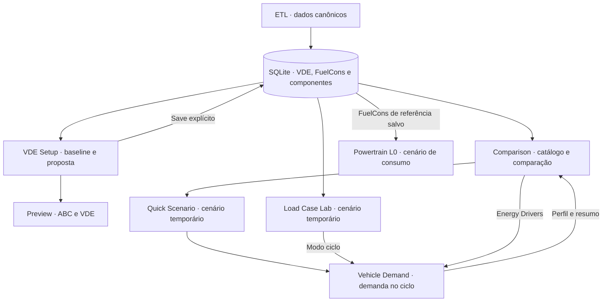

# Sprint 14C · Encerramento da Sprint 14

**Data:** 2026-11-15

**Baseline verificada:** [`3f0f00d4`](https://github.com/caiohfr/projects/commit/3f0f00d4fff8bb7a1f7b512800c440f2eadfcfb7)

**Decisão:** encerrar compreensão, auditoria e simplificação seletiva com entrega documental. A próxima sprint é **15 · Visual Identity & UX Consistency**.

## O que foi entregue

| Etapa | Evidência | Resultado |
|---|---|---|
| 14A · Arquitetura e Roadload | [PR #12](https://github.com/caiohfr/projects/pull/12), [#13](https://github.com/caiohfr/projects/pull/13), [#14](https://github.com/caiohfr/projects/pull/14) e [#15](https://github.com/caiohfr/projects/pull/15) | Mapa MBSE-lite, contrato e decisão de arquitetura, golden sintético, baseline parcial de desempenho, isolamento de mocks em dois testes e desenho integrado TARGET. |
| 14B · Auditoria de simplificação | [PR #16](https://github.com/caiohfr/projects/pull/16/files), [`SPRINT_14B_01_SIMPLIFICATION_CANDIDATES.md`](SPRINT_14B_01_SIMPLIFICATION_CANDIDATES.md) | Cinco fatias rastreadas e 12 candidatos avaliados. A decisão de fechamento substitui a proposta de executar B-02: os patches de filtros e leitura duplicada foram adiados por ganho localizado. B-03 foi dispensada. |
| 14C · Revisão e handoff | Este fechamento e [atualização do gate 14A](SPRINT_14A_ROADLOAD_DESIGN_GATE.md#atualização-de-fechamento--14c-2026-11-15) | Mapa atual, evidência nova, dívidas com gatilhos e roteiro de demonstração para a Sprint 15. |

O diff do PR #16 contém apenas o documento de auditoria. A 14C registra a decisão, o fluxo atual e os testes do baseline. A inspeção do diff sustenta a preservação de TOTAL/NET, massa, RRC, `compute_vde_series`, FuelCons, L0 e persistência explícita nesta entrega.

## Fluxo implementado



As setas ligam entradas e saídas dos fluxos. Para demonstrar o mesmo veículo no L0, selecione explicitamente o FuelCons salvo usado como referência. O [diagrama de arquitetura TARGET](../architecture/ECODRIVE_ENGINEERING_ARCHITECTURE_TARGET_v0.2.md) descreve também a decomposição integrada de Roadload e o powertrain L1–L3 como evoluções.

| Fatia | Onde começar a leitura | O que verificar |
|---|---|---|
| ETL → DB | [`etl/scripts/`](../../etl/scripts/) e [fechamento da Sprint 12](SPRINT_12_FINAL_CLOSURE.md) | ETL prepara a base canônica. Database Management faz a revisão e manutenção operacional. |
| VDE Setup → Preview/Save | [`pages/VDE_Setup.py`](../../pages/VDE_Setup.py), [`vde_request_compact_adapter.py`](../../src/vde_core/vde_request_compact_adapter.py) e [`vde_request_compact_persistence.py`](../../src/vde_core/vde_request_compact_persistence.py) | Preview chama `resolve_vde_request()` e `build_vde_setup_preview()`. O ponto de entrada de Save da página atual é `save_v22_request()`. Este rastreio esclarece a referência a `save_vde_setup_result()` no mapa da B-01. |
| Quick / Load Case → Vehicle Demand | [`quick_scenario/resolver.py`](../../src/vde_core/quick_scenario/resolver.py), [`vehicle_demand/load_case.py`](../../src/vde_core/vehicle_demand/load_case.py) e [`vehicle_demand/engine.py`](../../src/vde_core/vehicle_demand/engine.py) | Cenários temporários. `calculate_vehicle_demand()` recebe a requisição e o ciclo. Load Case tem também modos de velocidade fixa e varredura. |
| Comparison → Energy Drivers | [`comparison_report_service.py`](../../src/vde_core/comparison_report_service.py) e [`comparison_vehicle_demand_viewmodels.py`](../../src/vde_app/comparison_vehicle_demand_viewmodels.py) | O serviço monta o dataset. Energy Drivers chama o engine de Vehicle Demand. O adapter de Vehicle Demand ainda importa a resolução TOTAL/NET de Comparison. |
| Powertrain L0 / FuelCons | [`pages/Powertrain_Scenario.py`](../../pages/Powertrain_Scenario.py), [`system_scenario/resolver.py`](../../src/vde_core/system_scenario/resolver.py), [`l0_adapter.py`](../../src/vde_core/system_scenario/l0_adapter.py) e [`fuel_estimation.py`](../../src/vde_core/fuel_estimation.py) | L0 usa FuelCons de referência salvo, resolve o cenário e calcula consumo. O fluxo manual/importado tem engine e superfície legada. A gravação de um resultado depende de Save explícito. |

## Decisões e gatilhos

| Decisão | Candidatos e evidência | Onde retomar |
|---|---|---|
| **KEEP** | C06, C07, C10 e C12. Os wrappers compatíveis, a orquestração do Lab e os utilitários históricos de ETL têm uso próprio. | Quick, Load Case, Powertrain e ETL. Reavaliar quando um fluxo depender de mudança concreta nessas fronteiras. |
| **DEFER · simplificação localizada** | C01 e a leitura duplicada de FuelCons no Quick. São repetição de filtros e de leitura observadas por inspeção. A contagem de consultas do Quick ainda carece de medição. | Comparison quando o catálogo for alterado. Quick quando medição mostrar impacto ou quando o carregamento de origem for revisitado. |
| **DEFER · dependências** | C02 e C05. A regra TOTAL/NET mora no serviço de Comparison. Quick e Comparison também acessam FuelCons pelo serviço administrativo. | Roadload, Vehicle Demand e repositório de FuelCons. Primeiro mapear consumidores e campos, provar paridade de TOTAL/NET para transmissão existente, temporária e ausente, e manter compatibilidade dos imports. |
| **DEFER · legado** | C03, C04 e C09. Há caminhos distintos de preview em VDE Setup. A distinção entre zero e ausente no editor legado de FuelCons foi levantada por inspeção. | VDE Setup e Powertrain. Provar consumidores e paridade de preview/save antes de deprecar. Reproduzir zero no editor antes de tratar como defeito. |
| **DEFER · física / históricos** | C08 e C11. Avaliação ABC no Lab e guardas de staging dos scripts ETL. `RoadLoadModel` já calcula força e potência. A evolução da classe e eventual compartilhamento do avaliador dependem do gate físico. | [Gate Roadload](SPRINT_14A_ROADLOAD_DESIGN_GATE.md) e ETL. Cobrir escalares, vetores, overlays e no-write para ABC. Para ETL, confirmar proteções e reprodutibilidade por script. |

## Evidência executada em 2026-11-15

Checkout isolado de `3f0f00d4` em Linux, Python 3.12.14, NumPy 2.3.3, pandas 2.3.2, Streamlit 1.49.1 e Plotly 6.3.0. Comandos executados a partir da raiz `EcoDrive-Analyst`, usando o Python do ambiente de testes.

```bash
python -m unittest -v tests.test_vde_request_resolver tests.test_vde_workflow_service tests.test_vde_request_compact_persistence tests.test_vehicle_demand_load_case tests.test_quick_scenario_resolver_parity tests.test_comparison_report_service tests.test_fuel_estimation tests.test_pwt_fuel_energy_service_pse_reference tests.test_roadload_load_case_lab_ui tests.test_comparison_report_page_smoke tests.test_powertrain_system_scenario_ui
python scripts/architecture/sprint14a04_golden.py capture --out /tmp/ecodrive-14c-roadload-golden.json
python -m unittest -v etl.tests.test_sprint_12e_migration_rehearsal
```

- **Suíte direcionada:** 338 aprovados em 28,386 s, com a base sintética de QA preparada no caminho usado pelo app (`data/db/eco_drive_qa.db`, ignorado pelo Git).
- **Primeira execução sem a fixture preparada:** dois AppTests de troca para QA falharam com `sqlite3.OperationalError: no such table: fuelcons_db`. Foram `test_switch_to_qa_button_points_runtime_db_at_the_canonical_qa_instance` e `test_switch_to_qa_button_does_not_reseed_or_mutate_canonical_qa`. A base sintética foi gerada com `seed_qa_database()` em diretório temporário e copiada para o caminho de QA do checkout isolado. Os dois passaram na repetição completa, incluindo a verificação de hash durante a troca de banco.
- **Golden sintético:** captura concluída com asserts analíticos. SHA-256 do artefato local `a83af20f9fe49a4c38cbd3b96d57022656d34184642a60b31bedccd73f7520cb`.

| Contrato | Verificação direta nesta execução |
|---|---|
| VDE Setup | `test_build_vde_setup_preview_does_not_persist`, `test_build_vde_setup_preview_subtracts_transmission_losses_for_net` e `test_save_reload_roundtrip_preserves_results_and_audit`. |
| Roadload e Vehicle Demand | Golden com asserts analíticos de força/potência, pneu ISO, NET ausente e residual negativo. `test_total_net_external_overlay_preserves_gap` e `test_calculation_performs_no_db_writes` no Lab. |
| Quick / Comparison | `test_combined_change_matches_both_canonical_resolvers_independently` e `test_filters_match_the_lightweight_catalog_exactly`. O teste de catálogo existente compara conjuntos de IDs. |
| FuelCons / L0 | `test_run_fuel_estimation_does_not_persist`, `test_save_fuel_estimate_result_persists_insert_payload`, `test_derive_reference_pse_net_basis_selection` e AppTest `test_current_only_renders_compact_matrix_and_calculates`. |
| PR #14 | `test_component_lookup_provenance_does_not_change_parasitic_math` e `test_axle_hubs_lookup_snapshot_preserves_boundary_metadata`. O PR injeta explicitamente o mock em cada teste. |
| ETL histórico | **GAP reproduzido.** `Sprint12EMigrationRehearsalTest.setUpClass` falha com `FileNotFoundError` para `etl/data/processed/sprint_12e_migration_rehearsal/rehearsal_summary.json`. Zero testes desse módulo chegaram a executar. |

O golden foi capturado do baseline e validado pelos asserts independentes. Como este fechamento é documental, inexiste um segundo estado de código de produção para comparação pós-refactor. A suíte completa e a validação visual em navegador ficam sem evidência nesta 14C. Os AppTests acima cobrem execução automatizada das páginas.

## Handoff · Sprint 15 de UX

Usar a as referências visuais em `06_REFERENCIAS_UX/` do pacote canônico de 12/11 e os [princípios de UX do repo](../architecture/UX_PRINCIPLES.md) para aplicar identidade visual, hierarquia, navegação e estados vazios, de carregamento e de erro às páginas atuais. Preservar rastreabilidade da referência, hipótese, ciclo, base TOTAL/NET, proveniência e ações explícitas de save. Validar os fluxos alterados com AppTest, quando aplicável, e smoke em navegador real com capturas.

**Roteiro de demo.** Escolher um veículo público ou sintético no VDE Setup. Mostrar uma proposta de pneu, o resultado de energia nas rodas no Comparison e os drivers da diferença. Para estimar o efeito no consumo, abrir o Powertrain L0, selecionar explicitamente o FuelCons de referência e mostrar a hipótese de eficiência. O mapa atual serve como slide técnico de apoio. O ganho da Sprint 14 para essa história é a rastreabilidade do fluxo e a evidência dos contratos usados na demo.
